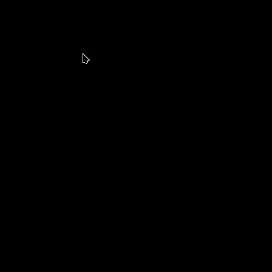

# kwin-effects-ba-click-fx

[](LICENSE)

Chinese documentation: [README.md](README.md)

**A KDE Plasma KWin click effect and cursor trail plugin ported parameter by parameter from the Blue Archive Unity UI/FX_Touch effect.**

`kwin-effects-ba-click-fx` recreates the ParticleSystem, TrailRenderer and post-processing parameters from `FX_Touch` in native KWin rendering. Clicks play the center disc, dissolving rings and Ring3 particles; holding a selected trigger button while moving creates the Ribbon trail and Ring4 distance-emitter particles (left button by default). Rendering uses native C++ / OpenGL, a linear RGBA16F scene and Unity PPv2 MXFinalBloom without a scripting runtime.



## Features

- Parameter-by-parameter Unity port rather than a look-alike redesign.
- Recreates Ring, MeshTri, Ring3, Ring4 and TrailRenderer colors, sizes, rotation, lifetime, UV animation and HDR intensity.
- Uses the original Cylinder002 mesh and per-angle UVs; particle textures are sampled directly by shaders.
- Linear RGBA16F scene, HDR particle blending and Unity PPv2 MXFinalBloom.
- Sparse damage regions so only changed pixels are imported, processed and composited.
- Multi-monitor, HiDPI and different output scale support.
- Native KWin pointer input samples trails once per actual presentation frame on the cursor’s output.
- KCM configuration page, repaint-region markers and segmented CPU/GPU performance logs.
- Live preview in the settings page; changes are saved only on Apply.

## Requirements

- KDE Plasma 6 / KWin 6.8 as the primary target, with 6.6/6.7 compatibility retained.
- OpenGL compositing; there is no CPU rendering fallback.
- CMake 3.20+, ECM 6.22+, Qt 6.10+ and KF6 6.22+.
- KWin development files matching the running KWin version.

KWin native effect plugins are ABI-bound to `EffectPluginFactory`. Version 6.8 is the default development and validation target; API differences for 6.6/6.7 are isolated in `src/kwincompat.*`. Rebuild with matching development packages after a KWin upgrade.

## Install

Arch Linux:

```bash
sudo pacman -S --needed base-devel cmake extra-cmake-modules kservice kwin libepoxy qt6-base qt6-declarative vulkan-headers
```

Fedora:

```bash
sudo dnf install -y cmake extra-cmake-modules gcc-c++ gettext kf6-kcmutils-devel kf6-ki18n-devel kf6-kservice-devel kwin-devel libdrm-devel libepoxy-devel qt6-qtbase-devel qt6-qtdeclarative-devel qt6-qttools-devel vulkan-headers
```

Kubuntu:

```bash
sudo apt-get update
sudo apt-get install -y --no-install-recommends appstream ca-certificates cmake extra-cmake-modules g++ git kwin-dev libdrm-dev libepoxy-dev libkf6config-dev libkf6coreaddons-dev libkf6i18n-dev libkf6kcmutils-dev libkf6service-dev libkf6windowsystem-dev ninja-build pkg-config qt6-base-dev qt6-declarative-dev qt6-tools-dev libvulkan-dev
```

CI and `scripts/verify-release.sh` additionally use `appstream`, `ripgrep` and `ninja-build`.

Run from the project directory:

```bash
./install-local.sh --system
```

Run the script as your normal user; it requests administrator access only for `/usr`. Then open **System Settings -> Appearance & Style -> Desktop Effects**, search for **BA Click FX**, and enable it. Log out and back in after a first install or KWin upgrade if it is not listed.

Useful options:

```bash
JOBS=4 ./install-local.sh --system
./install-local.sh --no-reload
./install-local.sh --help
```

Settings are grouped into **Effects**, **Appearance**, **Where to show**, and **Diagnostics** tabs. Common click and trail controls stay on the first tab; timing and scaling, window filters, and troubleshooting tools have their own pages. Appearance settings scroll when several displays are present.

To exclude an application, enable **Exclude specified applications**, click **Pick window…**, then select one of its windows; KWin supplies the application identity and the page asks for confirmation before adding it. Steam games without a desktop-file identity combine a valid App ID with the executable name. Lutris run UUIDs change between launches, so Lutris and other Wine games instead combine the Wine prefix with the executable name. Both forms allow a launcher and its game window to be excluded independently. Unity-authored colors, particle counts, trail width, emission spacing and Bloom parameters remain fixed.

Click animations are enabled by default, with only the left button selected; fullscreen suppression is off by default. Left, right and middle buttons can be enabled in any combination. Each newly pressed selected button plays one click burst; selected buttons share one trail until the last is released. Selecting none disables button triggers while **Always show trail** remains independent. Normal button actions such as context menus and middle-click paste continue to work.

When enabled, fullscreen suppression also stops emission when a held drag enters a fullscreen window. Leaving it starts a new stroke at the current position without connecting across the blocked area. Existing particles and trails fade naturally. Desktop and application eligibility for held trails remains determined at the first selected button press.

Remove a system installation with `./uninstall-local.sh --system`; use `--user` for a user installation. Add `--purge-config` to remove saved settings and the enabled state.

### Per-display scaling

Enable **Enable per-display scaling** to tune each output independently. Settings are stored in `~/.config/kwinrc` under `[Effect-ba-click-fx]`; `OutputScaleOverrides` is a JSON object keyed by output UUID:

```ini
OutputScaleEnabled=true
OutputScaleOverrides={"<output-uuid>":1.25}
```

Find UUIDs with `qdbus-qt6 org.kde.KWin /Effects debug kwin4_effect_ba_click_fx outputs-json`. Reset saves an explicit `1.00`; legacy name-only entries are intentionally not migrated.

## Testing and compatibility

Automated tests, nested KWin sessions, dual-monitor/HiDPI/HDR checks and rollback notes are documented in [TESTING.md](TESTING.md).

## Logging and diagnostics

Use the configuration page to set log level, copy diagnostics, generate a report or open the diagnostics directory. If the page is unavailable:

```bash
kwriteconfig6 --file kwinrc --group Effect-ba-click-fx --key LogLevel 3
qdbus-qt6 org.kde.KWin /Effects reconfigureEffect kwin4_effect_ba_click_fx
journalctl --user --since=-2min -o cat QT_CATEGORY=kwin_effect_ba_click_fx
```

Log levels are `0=off`, `1=errors`, `2=instances`, `3=frame statistics` and `4=verbose debugging`. Query status or structured diagnostics with:

```bash
qdbus-qt6 org.kde.KWin /Effects debug kwin4_effect_ba_click_fx status
qdbus-qt6 org.kde.KWin /Effects debug kwin4_effect_ba_click_fx diagnostics
```

Reports are stored in `~/.cache/ba-click-fx/diagnostics/`. `DebugDamage` draws requested repaint regions and should be disabled for performance measurements.

## Hot-reload limitations

`reconfigureEffect` reloads configuration only. `unloadEffect` / `loadEffect` can recreate the effect object, but Qt caches the mapped native plugin factory, so replacing an already loaded `.so` does not replace code in the current KWin process. Configuration changes apply immediately; C++ changes require a new KWin process. Use `test-nested.sh` for development and log out after a system installation.

## Rendering architecture

Each frame imports changed desktop pixels into a linear RGBA16F scene, draws Trail, Ring and MeshTri in the UIAlwaysVisible pass, and builds the PPv2 MXFinalBloom pyramid. The LetterBox pass adds Ring3 and Ring4 after Bloom sampling. The final composite applies the KWin output transfer function. FBOs and Bloom pyramids are reused per output; damage regions reduce unchanged texel work without changing shaders, sampling kernels, geometry or particle parameters.

## License

The project code is licensed under [GNU GPL v3.0 or later](LICENSE). Blue Archive names, trademarks and game-derived visual assets belong to their respective rights holders and are not covered by the project code license. This is an unofficial technical research and desktop visual effect implementation.

Further plans are tracked in [TODO.md](TODO.md). Parameter analysis and cross-platform implementation references are available at [ba-click-fx](https://github.com/CialloKing/ba-click-fx).
